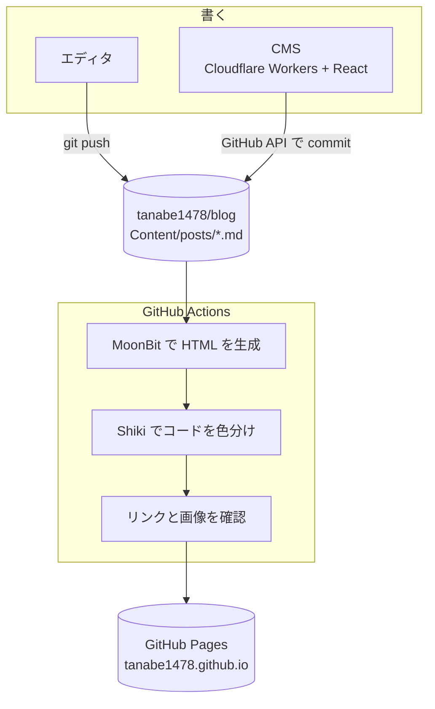

# このブログの技術スタック（2026年10月）

このブログは何度か作り直している。Swift Publish で生成していた頃に[構成の記事](/posts/blog-structure)を書いたが、その後 GitHub Issues で書いていた diary を統合したり、生成の仕組みを入れ替えたりして、ほとんど別物になった。今の構成をまとめておく。

## 全体の流れ

記事は Markdown で repository に置いている。push すると GitHub Actions がサイトを生成して、GitHub Pages に deploy する。記事はエディタで書いて push してもいいし、ブラウザの CMS から書いてもいい。



## 生成は MoonBitで書いた静的サイトジェネレータ

以前は Swift Publish で生成していたが、今は MoonBit で書いた [moonbit-ssg](https://github.com/tanabe1478/moonbit-ssg) で生成している。いきなり置き換えるのは怖かったので、最初は Publish と同じ HTML が出ることだけを目標にした。移行前の全ファイルがバイト単位で一致するのを確かめてから切り替えている。

moonbit-ssg は汎用のライブラリとして使い、このブログ専用の設定やテーマはブログの repository 側に置いた。最初は moonbit-ssg の中にブログ用のコードがあったが、依存の向きが逆で触りにくかったので分けた。moonbit-ssg は git submodule で取り込んでいる。

ローカルで確認するときはこれだけで済む。

```bash
scripts/build_site.sh
python3 -m http.server 4173 --directory Output
```

MoonBit の toolchain と Node の版は mise で固定している。

## デザインは Penpot と design token

見た目は Penpot でデザインしている。色や文字の大きさ、余白、幅、アニメーションの時間まで design token にして repository の `design/tokens.json` に置いた。Penpot と同じ形式なので、どちらで変えても取り込める。

## コードと図

コードブロックは、生成したあとに Node のスクリプトで [Shiki](https://shiki.style/) を通して色分けしている。色は CSS 変数のテーマにして token から決めている。

Mermaid の図はブラウザで描いている。図のあるページだけ mermaid を読み込んで、色は同じく token から渡す形になっている。

## CMS は Cloudflare Workers

エディタを開いて push するのも面倒になってきたので、ブラウザから書ける CMS を Cloudflare Workers の上に置いた。画面は React で、Markdown の preview を見ながら書ける。

保存すると Worker が GitHub API で `main` に commit する。

## まとめ

その時々で興味のある技術スタックで遷都を繰り返してるしデザインも同様。個人サイトなのでそれで良いとも思っている。
