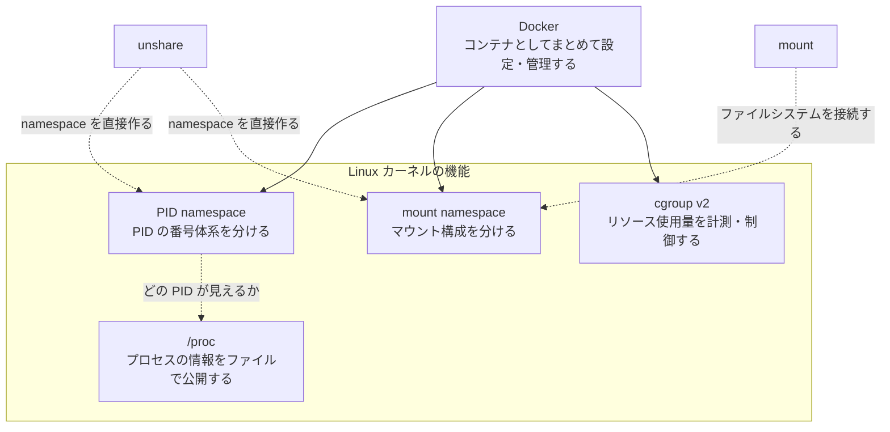
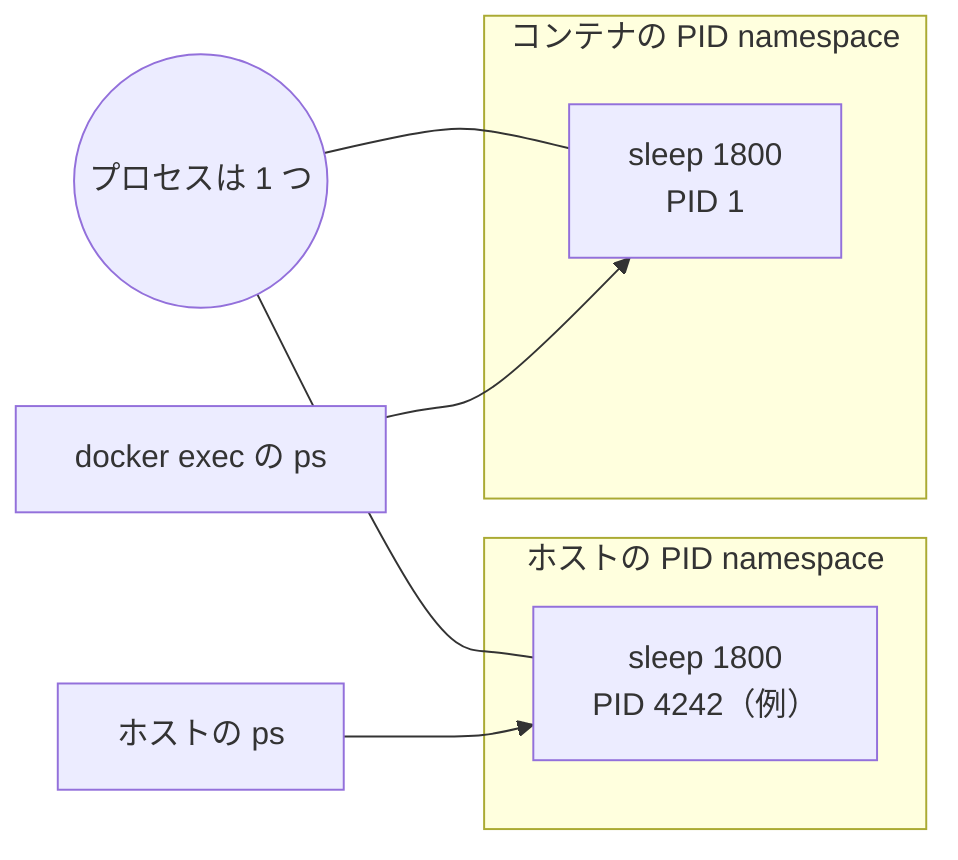
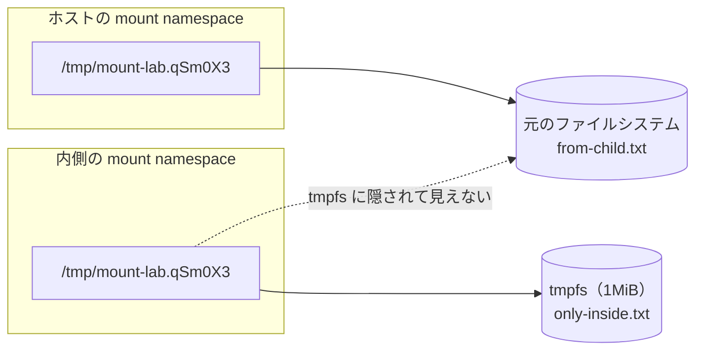

# Dockerの仕組み（WIP）

Dockerをいつまでも雰囲気で使っているのでもう少し掘り下げる。


## 登場するもの

- PID namespace
    - プロセスのPIDの番号体系や、PIDを指定して対象に出来る範囲を分ける
- mount namespace
    - 何をどこへマウントするかという構成を分ける
- /proc
    - カーネルがプロセスなどの情報をファイルの形で公開する場所
- cgroup v2
    - プロセス群のリソース使用量を計測、制御する
- unshare
    - namespaceを直接作って、指定したプログラムを動かすコマンド
- mount
    - ファイルシステムをあるディレクトリに接続するコマンド
- Docker
    - この辺の機能を組み合わせてコンテナとして設定、管理できる



## 2. Docker で同じプロセスのPIDを比較

sleepだけを動かすコンテナを作る

```bash
sudo docker run -d --name pid-lab --network none alpine:3.23
sleep 1800
```

ホスト側のPIDを取得してホストのpsで確認する


```bash
host_pid=$(sudo docker inspect --format '{{}.State.Pid}}' pid-lab)
ps -p "$host_pid" -o pid,ppid,user,args
```


コンテナの中から確認する

```bash
sudo docker exec pid-lab ps -o pid,ppid,user,args
```

カーネルが公開する情報を読む

```bash
grep -E '^(Name|Pid|PPid|NSpid):' "/proc/$host_pid/status"
```

結果として同じsleepに対して異なるPIDがホスト側とコンテナ内で割り当てられているのがわかる

プロセスが二個あるのではなく1個のプロセスにPID namespaceごとに番号がついてる。



外側のPIDを知らないから操作できないのではなく、通常のPID指定では内側の番号体系から外側のプロセスをさせない。

## Dockerなしであれこれ

チューター代わりに使ってるモデルからDockerなしでDockerがやっていることをやると良いという話をされたのでたしかにとなったので叩いたコマンドの説明

DockerなしでPID namespaceを作る

これでnamespaceを直接作って新しいPID namespaceも作って、子プロセスを作ってそこで指定したプログラムが実行できる。合わせてmount namespaceも新しくしてその中で/procをマウントし直してる

実行しているコマンド側は参照している/procプロセス一覧を出してPID,親のPID、コマンド名を表示する

```bash
sudo unshare --pid --fork --mount-proc ps -e -o pid,ppid,comm
```

結果は内側の psだけが表示される


 ```text
   PID  PPID  COMMAND
     1     0  ps
 ```

プロセス自身がどのPID namespaceに所属するかと観察用のpsがどの/procを読むかは別の話でDockerはこの辺をうまいことやってくれる

cgourpでCPU時間を制限する

namespaceを分けずに普通のプロセスのリソース使用量を制限する

```bash
sudo mkdir /sys/fs/cgourp/cpu-lab
```

ディレクトリを作る操作自体がカーネルへのcgroupを作るという指示になる。

プロセスを増やしてもグループ全体の予算は増えなかった。上限は共通らしい


### mount namespaceと、ファイルの実態を区別する

#### namespaceをわけるだけ


```bash
sudo unshare --mount --propagation private touch /tmp/mount-lab.qsm0X3/from-child.txt
```

その後ホスト側で確認する

```bash
ls -l /tmp/mount-lab.qSm0x3/from-child.txt
```

ホスト側からもファイルが見えた。
mount namespaceを分けても作成直後は同じファイルシステムの実態を参照していることがわかる。

- --mount：マウント構成の管理単位を分ける。
- --propagation private：マウント操作が外へ伝播しないようにす
   る。

#### 内側だけ別のtmpfsをマウントする

新しいmount namespaceの内側で実行する

```bash
mount -t tmpfs -o size=1m,nosuid,nodenv,noexec tmpfs /tmp/mount-lab.qSm0X3
```

 - -t tmpfs：ファイルシステムの種類を指定する。
 - size=1m：容量の上限を1MiBにする。
 - 最後のパス：そのファイルシステムを接続する場所。


表示の比較をすると元のfrom-child.txtは内側からは見えずにホスト側からは見える。そして新しいonly-inside.txtは内側からは見えてホスト側からは見えない



内側では別のファイルシステムを接続したので元の内容が隠れた。


